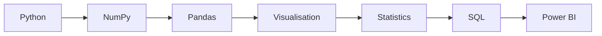

<h1 align="center">📊 Data Analytics Journey</h1>

<p align="center">
 My journey from Python beginner to Data Analyst, learning in public.
</p>

<p align="center">
  
  
  
  
</p>

---

## 🎯 Goal

Become a strong **Data Analyst**.

This repository is a record of what I learn, the code I write, and the projects I build.

📓 **Study notes:** [My Notion notes](https://app.notion.com/p/Python-17aa37d0ed5c8034b490d2bde1792796?source=copy_link)

---

## 🗺️ Roadmap



---

## 📈 Progress

| Phase | Topics | Status |
|:--|:--|:--:|
| 🐍 Python Fundamentals | Syntax, variables, data types, loops, functions | 🟡 In progress |
| 🔢 NumPy | Arrays, calculations | ⬜ Not started |
| 🐼 Pandas | Cleaning, transforming, analysing data | ⬜ Not started |
| 📉 Visualisation | Matplotlib, Seaborn | ⬜ Not started |
| 📐 Statistics | Descriptive stats, probability | ⬜ Not started |
| 🗄️ SQL | Queries, joins, aggregations | ⬜ Not started |
| 📊 Power BI | Dashboards, DAX basics | ⬜ Not started |

**Legend:** ✅ Done &nbsp;|&nbsp; 🟡 In progress &nbsp;|&nbsp; ⬜ Not started

---

## 🐍 Python Learning Log

| Day | Topic | Folder | Status |
|:--:|:--|:--|:--:|
| 01 | Introduction, syntax, comments, indentation, variables, `print()` | [`01-Python/Basics`](01-Python/Basics) | ✅ |
| 02 | Data types and type conversion | | ⬜ |
| 03 | Operators | | ⬜ |
| 04 | Input / Output and strings | | ⬜ |

*(Rows are added as I complete each topic.)*

---

## 🧰 Skills

| Area | Tools | Level |
|:--|:--|:--|
| Programming | Python | 🌱 Beginner |
| Data analysis | Pandas, NumPy | ⬜ Upcoming |
| Databases | SQL | ⬜ Upcoming |
| Business intelligence | Power BI, Excel | ⬜ Upcoming |
| Machine learning | scikit-learn | ⬜ Upcoming |

---

## 🚀 Projects

| Project | Skills used | Link |
|:--|:--|:--:|
| Python mini project | Variables, operators, loops | ⬜ Coming soon |
| Pandas analysis | Cleaning, grouping, insights | ⬜ Coming soon |
| SQL analysis | Joins, aggregations | ⬜ Coming soon |
| Power BI dashboard | KPIs, visuals | ⬜ Coming soon |
| Machine learning project | Model building, evaluation | ⬜ Coming soon |

---

## 📁 Repository Structure

```
data-analytics-journey/
├── README.md
├── 01-Python/
│   ├── Basics/
│   │   └── BasicsPractice.ipynb
│   └── notes/
├── 02-NumPy-Pandas/
├── 03-Visualisation/
├── 04-SQL/
├── 05-PowerBI/
└── projects/
```

*Folders are created as I reach each stage.*

---

## 🔁 How I Learn

```
Learn → Understand → Make Notes → Code → Practise
   → Solve a Real Problem → Review → Commit → Revise
```

I use AI as a tutor and reviewer, not a replacement for thinking. Every exercise is attempted myself first.

---

## 📬 Connect

- GitHub: [@ndiwate97](https://github.com/ndiwate97)
- LinkedIn: *[namrata-diwate](https://www.linkedin.com/in/namrata-diwate/)*
